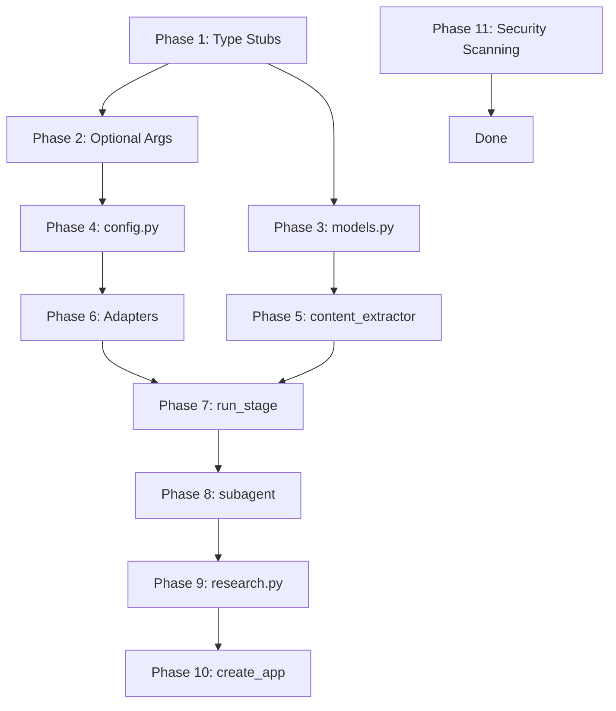

# Code Quality Improvement Plan (Plan 9)

**Date**: 2026-04-28  
**Status**: Draft - Ready for Review  
**Estimated Total Effort**: ~19.5 hours

---

## Executive Summary

Based on a comprehensive code quality review of the ainews codebase, this plan addresses:
- **50+ mypy type errors** (missing stubs, implicit Optional args, type mismatches)
- **5 high-complexity functions** (complexity >20) needing refactoring
- **Type annotation gaps** in config, models, and adapter code
- **Missing dependency vulnerability scanning** in CI pipeline

Expected outcome: mypy errors → ~0, complexity reduced by 60%+, added security scanning.

**Total Phases**: 11  
**High Priority**: Phases 1-3 (type safety foundation)  
**Medium Priority**: Phases 4-10 (annotations + refactoring)  
**Low Priority**: Phase 11 (security scanning)

---

## Phase 1: Type Stub Installation (30 min) [HIGH PRIORITY]

### Problem
50+ mypy errors stem from missing type stubs for `requests` and `PyYAML` libraries.

### Files Affected
- `services/search/session.py` - imports `requests`
- `adapters/session.py` - imports `requests`
- `schemas/common.py` - imports `yaml`
- `adapters/rss.py`, `adapters/api.py`, `adapters/web.py` - import `requests`

### Implementation Steps

1. **Install type stubs**:
   ```bash
   .venv/bin/pip install types-requests~=2.32.0 types-PyYAML~=6.0.0
   ```

2. **Update `pyproject.toml`** dev dependencies:
   ```toml
   [project.optional-dependencies]
   dev = [
       "pytest>=8.0,<9",
       "pytest-cov>=4.0,<5",
       "pytest-xdist>=3.0,<4",
       "ruff>=0.9.0,<1",
       "mypy>=1.0,<2",
       "types-requests~=2.32.0",    # NEW
       "types-PyYAML~=6.0.0",       # NEW
   ]
   ```

### Verification
```bash
.venv/bin/mypy . --exclude='.venv|.venv.bak|tests/' --ignore-missing-imports 2>&1 | grep -E "import-untyped" | wc -l
# Expected: 0
```

---

## Phase 2: Fix Implicit Optional Parameters (30 min) [HIGH PRIORITY]

### Problem
PEP 484 no longer treats `None` defaults as implicitly `Optional`. 7 parameters across 3 files need explicit typing.

### Files & Changes

#### `services/logging_utils.py` (4 parameters)

**Current** (lines 145-150, 177-181):
```python
def __init__(self, stage: str, base_logger: logging.Logger = None, task_id: str = None):
def get_pipeline_logger(stage: str, base_logger: logging.Logger = None, task_id: str = None) -> PipelineLogger:
```

**Fixed**:
```python
from typing import Optional

def __init__(self, stage: str, base_logger: Optional[logging.Logger] = None, task_id: Optional[str] = None):
def get_pipeline_logger(stage: str, base_logger: Optional[logging.Logger] = None, task_id: Optional[str] = None) -> PipelineLogger:
```

#### `services/search/__init__.py` (1 parameter)

**Current** (line 30):
```python
def get_search_provider(provider_id: str = None) -> BaseSearchProvider:
```

**Fixed**:
```python
from typing import Optional

def get_search_provider(provider_id: Optional[str] = None) -> BaseSearchProvider:
```

#### `adapters/base.py` (2 parameters)

**Current** (line 113):
```python
def _hash_ext_id(url: str = None, title: str = None) -> str:
```

**Fixed** (file already has `from __future__ import annotations`):
```python
def _hash_ext_id(url: str | None = None, title: str | None = None) -> str:
```

### Verification
```bash
.venv/bin/mypy services/logging_utils.py services/search/__init__.py adapters/base.py 2>&1 | grep "no_implicit_optional" | wc -l
# Expected: 0
```

---

## Phase 3: Fix models.py Type Errors (1 hour) [HIGH PRIORITY]

### Problem
`db.Model` is dynamically created at runtime, causing mypy `name-defined` errors. Also, `short_url` library lacks type stubs.

### Root Cause
Flask-SQLAlchemy creates `Model` class dynamically when `SQLAlchemy()` is instantiated. This is a known limitation (see [Flask-SQLAlchemy issue #1327](https://github.com/pallets-eco/flask-sqlalchemy/issues/1327)).

### Implementation Steps

#### Step 1: Add TYPE_CHECKING workaround to `models.py`

```python
import re
import secrets
from datetime import datetime, timezone
from typing import TYPE_CHECKING, Optional

import short_url

from extensions import db

# For type checking only - provides proper base class for mypy
if TYPE_CHECKING:
    from flask_sqlalchemy.model import Model
else:
    # At runtime, use the dynamically-created Model
    Model = db.Model
```

#### Step 2: Update all model class definitions

Change all occurrences of `class X(db.Model):` to `class X(Model):`:

| Line | Current | Fixed |
|------|---------|-------|
| 52 | `class Source(db.Model):` | `class Source(Model):` |
| 80 | `class Article(db.Model):` | `class Article(Model):` |
| 92 | `class Tag(db.Model):` | `class Tag(Model):` |
| 162 | `class Subscriber(db.Model):` | `class Subscriber(Model):` |
| 179 | `class Newsletter(db.Model):` | `class Newsletter(Model):` |
| + 10 more | Various models | Same pattern |

#### Step 3: Fix short_url return type errors (lines 24, 29)

```python
def encode_short_url(article_id: int) -> str:
    return _short_encoder.encode_url(article_id, min_length=6)  # type: ignore[no-any-return]

def decode_short_url(code: str) -> Optional[int]:
    try:
        return _short_encoder.decode_url(code)  # type: ignore[no-any-return]
    except (ValueError, TypeError):
        return None
```

### Verification
```bash
.venv/bin/mypy models.py 2>&1 | grep -E "name-defined|no-any-return" | wc -l
# Expected: 0
```

---

## Phase 4: Fix config.py Type Annotations (2 hours) [MEDIUM PRIORITY]

### Problem
Multiple type errors in `config.py` related to CELERY_BEAT_SCHEDULE, PipelineRootConfig type mismatches, and SECRET_KEY None handling.

### Issues & Fixes

#### Issue 4.1: CELERY_BEAT_SCHEDULE missing type annotation (line 97)

**Current**:
```python
CELERY_BEAT_SCHEDULE = {}
```

**Fixed**:
```python
from typing import Any

CELERY_BEAT_SCHEDULE: dict[str, Any] = {}
```

#### Issue 4.2: get_beat_schedule() parameter type mismatch (lines 113, 115, 190)

**Current**:
```python
@classmethod
def get_beat_schedule(cls, pipeline_cfg: dict | None = None) -> dict:
    if pipeline_cfg is None:
        pipeline_cfg = load_pipeline_config()  # Returns PipelineRootConfig, not dict
    schedule = pipeline_cfg.schedule  # mypy error: dict has no .schedule
```

**Fixed**:
```python
from typing import Union
from schemas.pipeline import PipelineRootConfig

@classmethod
def get_beat_schedule(cls, pipeline_cfg: Union[PipelineRootConfig, dict, None] = None) -> dict[str, dict[str, Any]]:
    if pipeline_cfg is None:
        pipeline_cfg = load_pipeline_config()
    
    # Handle both dict and PipelineRootConfig
    if isinstance(pipeline_cfg, dict):
        sched = pipeline_cfg.get("schedule", {})
    else:
        sched = pipeline_cfg.schedule
```

#### Issue 4.3: SECRET_KEY None incompatibility in DevelopmentConfig (line 197)

**Current**:
```python
class DevelopmentConfig(Config):
    SECRET_KEY = os.environ.get("SECRET_KEY")  # Returns str | None
```

**Fixed**:
```python
class DevelopmentConfig(Config):
    SECRET_KEY = os.environ.get("SECRET_KEY")
    assert SECRET_KEY is not None, "SECRET_KEY must be set for development"
```

### Verification
```bash
.venv/bin/mypy config.py 2>&1 | grep -E "var-annotated|union-attr|assignment" | wc -l
# Expected: 0
```

---

## Phase 5: Fix content_extractor.py Union Type Errors (1 hour) [MEDIUM PRIORITY]

### Problem
`trafilatura.bare_extraction()` returns `Document | dict[str, Any] | None`, but code uses dict-only access patterns (`.get()`, `["key"]`).

### Root Cause
Trafilatura v2.0.0 changed default return type from `dict` to `Document` class. The `Document` class has `.as_dict()` method.

### Implementation Steps

#### Step 1: Add import with alias (line 12 area)

```python
from readability import Document as ReadabilityDocument
from trafilatura.settings import Document as TrafilaturaDocument  # NEW
```

#### Step 2: Fix extraction result handling (lines 94-103)

**Current**:
```python
result = trafilatura.bare_extraction(downloaded, url=url, with_metadata=True)
if result:
    if result.get("text") and len(result["text"]) >= MIN_CONTENT_LENGTH:
        return ExtractionResult(
            url=url,
            text=result["text"],
            title=result.get("title"),
            author=result.get("author"),
            ...
        )
```

**Fixed**:
```python
result = trafilatura.bare_extraction(downloaded, url=url, with_metadata=True)
if result:
    # Normalize to dict regardless of whether result is Document or dict
    if isinstance(result, TrafilaturaDocument):
        result = result.as_dict()
    
    if result.get("text") and len(result["text"]) >= MIN_CONTENT_LENGTH:
        return ExtractionResult(
            url=url,
            text=result["text"],
            title=result.get("title"),
            author=result.get("author"),
            ...
        )
```

### Verification
```bash
.venv/bin/mypy services/content_extractor.py 2>&1 | grep -E "union-attr|index" | wc -l
# Expected: 0
```

---

## Phase 6: Fix Adapter Type Mismatches (2 hours) [MEDIUM PRIORITY]

### Problem
`ProviderManager` returns `BaseProvider`, but `get_search_provider()` is typed to return `BaseSearchProvider`. Also, `adapter_config` type cannot be determined.

### Root Cause
`BaseSearchProvider` inherits from `BaseProvider`, but mypy doesn't automatically narrow the return type.

### Implementation Steps

#### Option A: Make ProviderManager Generic (Recommended)

**Step 1**: Update `services/provider_base.py`:

```python
from typing import TypeVar, Generic

T_Provider = TypeVar("T_Provider", bound="BaseProvider")

class ProviderManager(Generic[T_Provider]):
    """Generic provider registry with caching and fallback support."""

    def __init__(self, category: str):
        self.category = category
        self._registry: dict[str, type[T_Provider]] = {}
        self._cache: dict[str, T_Provider] = {}

    def get_class(self, provider_type: str) -> type[T_Provider]:
        ...

    def get_cached(self, provider_id: str, config_loader: Callable) -> T_Provider:
        ...

    def get_with_fallback(self, config_loader: Callable, default_provider: Optional[str] = None) -> T_Provider:
        ...
```

**Step 2**: Update `services/search/base.py`:

```python
from services.provider_base import BaseProvider, ProviderManager, BaseSearchProvider

_manager: ProviderManager[BaseSearchProvider] = ProviderManager("search")

def get_search_provider_class(provider_type: str) -> type[BaseSearchProvider]:
    return _manager.get_class(provider_type)  # Now correctly typed
```

**Step 3**: Similarly update `services/llm/base.py` for `BaseLLMProvider`.

#### Option B: Use cast() (Simpler, Less Type Safe)

If generic refactoring is too invasive:

```python
from typing import cast

def get_search_provider_class(provider_type: str) -> type[BaseSearchProvider]:
    return cast(type[BaseSearchProvider], _manager.get_class(provider_type))
```

### Verification
```bash
.venv/bin/mypy services/search/ services/llm/ adapters/ 2>&1 | grep -E "return-value|has-type" | wc -l
# Expected: 0
```

---

## Phase 7: Refactor tasks/pipeline.py:run_stage (3 hours) [MEDIUM PRIORITY]

### Problem
`run_stage` function has complexity 35 (exceeds recommended 10). Function is 188 lines with many responsibilities.

### Current Structure (lines 202-390)

The function handles: request context setup, stage config checking, lock acquisition, timeout checking, LLM work execution, 3 exception handlers, metrics recording, and cleanup.

### Refactoring Plan

#### Extract Helper Function 1: `_extract_and_set_request_id()` (lines 232-236)

```python
def _extract_and_set_request_id(task_self) -> None:
    """Extract request ID from Celery task and set it in the logging context."""
    if task_self and hasattr(task_self, "request"):
        headers = getattr(task_self.request, "headers", None) or {}
        req_id = headers.get("request_id") if isinstance(headers, dict) else None
        if req_id:
            from services.logging_utils import set_task_request_id
            set_task_request_id(req_id)
```

#### Extract Helper Function 2: `_handle_disabled_stage()` (lines 238-244)

```python
def _handle_disabled_stage(stage: str, skip_next: str, article_id: int, run_id: Optional[int]) -> dict:
    """Handle disabled stage by dispatching to next stage or finalizing."""
    from services.pipeline_degradation import finalize_article as _finalize
    from services.pipeline_utils import _dispatch_next
    
    if skip_next == "finalize":
        _finalize(article_id)
    else:
        _dispatch_next(article_id, run_id=run_id, next_status=skip_next)
    return {"article_id": article_id, "decision": f"skip_{stage}"}
```

#### Extract Helper Function 3: `_acquire_stage_lock_and_load()` (lines 255-267)

```python
def _acquire_stage_lock_and_load(rc, task_self, article_id: int, stage: str) -> Union[tuple, dict]:
    """Acquire distributed lock and load article."""
    from extensions import get_redis
    from services.redis_utils import _acquire_stage_lock
    
    redis_client = get_redis()
    lock_key = f"ainews:stage_lock:{article_id}:{stage}"
    task_id = task_self.request.id or "manual"
    lock_acquired = _acquire_stage_lock(redis_client, lock_key, task_id, rc.timeout_seconds + 120)
    
    if not lock_acquired:
        logger.info("Stage %s already running for article %s, skipping", stage, article_id)
        return {"article_id": article_id, "skipped": True, "reason": "stage_locked"}
    
    article = db.session.get(Article, article_id)
    if not article:
        return {"article_id": article_id, "error": "not found"}
    
    return redis_client, lock_key, task_id, article
```

#### Extract Helper Function 4: `_check_and_handle_timeout()` (lines 269-292)

```python
def _check_and_handle_timeout(article, stage: str, run_id: Optional[int]) -> Optional[dict]:
    """Check pipeline timeout. Returns error dict if timeout exceeded."""
    from services.metrics import get_metrics
    from services.pipeline_monitor import record_stage_result
    
    if article.pipeline_started_at is not None:
        now_utc = datetime.now(timezone.utc).replace(tzinfo=None)
        elapsed = (now_utc - article.pipeline_started_at).total_seconds()
        timeout = _get_pipeline_timeout_seconds()
        if elapsed > timeout:
            logger.error("Article %s exceeded pipeline timeout (%.0fs > %ds), dead-lettering", article.id, elapsed, timeout)
            _transition_article_status(article, PipelineStatus.FAILED)
            article.last_error = f"pipeline timeout exceeded ({elapsed:.0f}s)"
            try:
                db.session.commit()
            except SQLAlchemyError:
                db.session.rollback()
                raise
            record_stage_result(stage, success=False, run_id=run_id)
            get_metrics().counter_inc("pipeline.timeout_exceeded", labels={"stage": stage})
            return {"article_id": article.id, "error": "pipeline_timeout"}
    return None
```

#### Extract Helper Function 5: `_get_failure_reason()` (lines 349-357)

```python
def _get_failure_reason(exc) -> str:
    """Determine the reason code for a stage failure."""
    if isinstance(exc, RateLimitError):
        return "rate_limit"
    elif isinstance(exc, ProviderTimeoutError):
        return "timeout"
    elif isinstance(exc, ProviderServerError):
        return "server_error"
    elif isinstance(exc, AuthError):
        return "auth"
    return "unknown"
```

#### Extract Helper Function 6: `_record_stage_failure_metrics()` (consolidates lines 316-321, 335-338, 359-362)

```python
def _record_stage_failure_metrics(stage: str, t0: float, run_id: Optional[int], reason: str) -> None:
    """Record metrics for a failed stage."""
    from services.metrics import get_metrics
    from services.pipeline_monitor import record_stage_result
    
    record_stage_result(stage, success=False, run_id=run_id, reason=reason)
    get_metrics().histogram_observe(
        "pipeline.stage_duration_seconds",
        time.monotonic() - t0,
        labels={"stage": stage, "success": "false"},
    )
```

#### Extract Helper Function 7: `_handle_stage_success()` (lines 299-312)

```python
def _handle_stage_success(article, stage: str, t0: float, run_id: Optional[int]) -> None:
    """Handle successful stage completion."""
    from services.metrics import get_metrics
    from services.pipeline_monitor import record_stage_result
    
    article.retry_count = 0
    article.last_error = None
    try:
        db.session.commit()
    except SQLAlchemyError:
        db.session.rollback()
        raise
    record_stage_result(stage, success=True, run_id=run_id)
    get_metrics().histogram_observe(
        "pipeline.stage_duration_seconds",
        time.monotonic() - t0,
        labels={"stage": stage, "success": "true"},
    )
```

#### Extract Helper Function 8: Exception Handlers (lines 314-378)

```python
def _handle_soft_timeout(article_id: int, stage: str, t0: float, run_id: Optional[int]) -> None:
    """Handle SoftTimeLimitExceeded exception."""
    _record_stage_failure_metrics(stage, t0, run_id, "timeout")
    
    exc_article = db.session.get(Article, article_id)
    if exc_article:
        exc_article.last_error = f"{stage}: soft time limit exceeded"
        exc_article.retry_count = (exc_article.retry_count or 0) + 1
        exc_article.total_retries = (exc_article.total_retries or 0) + 1
        try:
            db.session.commit()
        except SQLAlchemyError:
            db.session.rollback()
            raise

def _handle_circuit_open(article_id: int, stage: str, t0: float, run_id: Optional[int], exc, task_self) -> Optional[dict]:
    """Handle CircuitOpenError."""
    _record_stage_failure_metrics(stage, t0, run_id, "circuit_open")
    
    exc_article = db.session.get(Article, article_id)
    if exc_article and _handle_stage_failure(exc_article, stage, exc, run_id=run_id):
        return {"article_id": article_id, "result": "degraded"}
    logger.error("%s failed for article %s: no providers available", stage.title(), article_id)
    return None

def _handle_generic_exception(article_id: int, stage: str, t0: float, run_id: Optional[int], exc, provider_id, model, task_self) -> Optional[dict]:
    """Handle generic Exception."""
    if provider_id:
        from services.llm import record_provider_failure
        record_provider_failure(provider_id, model)
    
    reason = _get_failure_reason(exc)
    _record_stage_failure_metrics(stage, t0, run_id, reason)
    
    exc_article = db.session.get(Article, article_id)
    if exc_article and _handle_stage_failure(exc_article, stage, exc, run_id=run_id):
        return {"article_id": article_id, "result": "degraded"}
    
    if run_id:
        _log_pipeline(run_id, stage, "error", "Article %s: %s", article_id, exc, article_id=article_id)
    logger.error("%s failed for article %s: %s", stage.title(), article_id, exc)
    return None
```

#### Extract Helper Function 9: `_cleanup_stage_resources()` (lines 379-389)

```python
def _cleanup_stage_resources(limiter, redis_client, lock_key: str, task_id: str, rc, model) -> None:
    """Release limiter slot and Redis stage lock."""
    if limiter is not None:
        limiter.release(rc.provider, model if model is not None else None, rc.timeout_seconds)
    if redis_client is not None:
        try:
            from services.redis_utils import release_lock
            release_lock(redis_client, lock_key, task_id)
        except redis.exceptions.RedisError as e:
            logger.warning("Failed to release stage lock %s: %s", lock_key, e)
```

#### Simplified `run_stage` After Refactoring (estimated 40-50 lines)

```python
def run_stage(stage: str, article_id: int, work_fn: Callable, task_self=None, run_id=None, skip_next=None):
    """Execute a pipeline stage with proper resource management."""
    _extract_and_set_request_id(task_self)
    
    rc = get_role_config(stage)
    if not rc.enabled:
        return _handle_disabled_stage(stage, skip_next, article_id, run_id)
    
    result = _acquire_stage_lock_and_load(rc, task_self, article_id, stage)
    if isinstance(result, dict):
        return result
    redis_client, lock_key, task_id, article = result
    
    timeout_result = _check_and_handle_timeout(article, stage, run_id)
    if timeout_result:
        return timeout_result
    
    limiter = get_limiter()
    # ... acquire limiter, execute work_fn, handle results ...
    # Using extracted helpers for success/failure paths
    
    finally:
        _cleanup_stage_resources(limiter, redis_client, lock_key, task_id, rc, model)
```

### Expected Complexity Reduction
- `run_stage`: 35 → ~10
- Lines: 188 → ~50

---

## Phase 8: Refactor services/subagent.py: _evaluate_condition and _eval_node (4 hours) [MEDIUM PRIORITY]

### Problem
`_evaluate_condition` has complexity 35, `_eval_node` has complexity 31. Both use deeply nested if/elif chains and have a bug with boolean operations.

### Bug Identified
Line 1015 uses `operator.and_` and `operator.or_` (bitwise operators) for logical operations. For >2 operands, this fails. Should use `all()` and `any()`.

### Refactoring Plan

#### Step 1: Move constants to module level (around line 27-30)

```python
from typing import Callable

_ALLOWED_OPS: dict[type[ast.AST], Callable[..., Any]] = {
    ast.Eq: operator.eq,
    ast.NotEq: operator.ne,
    ast.Lt: operator.lt,
    ast.LtE: operator.le,
    ast.Gt: operator.gt,
    ast.GtE: operator.ge,
    ast.In: lambda a, b: a in b,
    ast.NotIn: lambda a, b: a not in b,
}

_ALLOWED_NAMES: frozenset[str] = frozenset({"True", "False", "None", "results", "previous"})

_BOOL_OP_HANDLERS: dict[type[ast.AST], Callable[..., Any]] = {
    ast.And: lambda values: all(values),
    ast.Or: lambda values: any(values),
}
```

#### Step 2: Create `ConditionEvaluator` class

```python
class ConditionEvaluator:
    """Evaluates condition expressions against a context using AST-based parsing."""
    
    def __init__(self, context: dict[str, Any]):
        self.context = context
        self._handlers: dict[type[ast.AST], Callable[[ast.AST], Any]] = {
            ast.Expression: self._handle_expression,
            ast.BoolOp: self._handle_bool_op,
            ast.UnaryOp: self._handle_unary_op,
            ast.Compare: self._handle_compare,
            ast.Name: self._handle_name,
            ast.Constant: self._handle_constant,
            ast.Attribute: self._handle_attribute,
            ast.Subscript: self._handle_subscript,
        }
    
    def evaluate(self, condition: str) -> bool:
        """Evaluate a condition expression."""
        try:
            tree = ast.parse(condition, mode="eval")
        except (SyntaxError, ValueError):
            return False
        
        try:
            return bool(self._eval_node(tree))
        except ValueError:
            return False
    
    def _eval_node(self, node: ast.AST) -> Any:
        """Dispatch to appropriate handler based on node type."""
        node_type = type(node)
        handler = self._handlers.get(node_type)
        if handler is None:
            raise ValueError(f"Unsupported node type: {node_type.__name__}")
        return handler(node)
    
    def _handle_expression(self, node: ast.Expression) -> Any:
        return self._eval_node(node.body)
    
    def _handle_bool_op(self, node: ast.BoolOp) -> Any:
        values = [self._eval_node(v) for v in node.values]
        if isinstance(node.op, ast.And):
            return all(values)  # FIX: was using operator.and_ (bitwise)
        elif isinstance(node.op, ast.Or):
            return any(values)  # FIX: was using operator.or_ (bitwise)
        raise ValueError(f"Unsupported boolean operator: {type(node.op).__name__}")
    
    def _handle_unary_op(self, node: ast.UnaryOp) -> Any:
        if isinstance(node.op, ast.Not):
            return not self._eval_node(node.operand)
        raise ValueError(f"Unary operations not allowed in conditions")
    
    def _handle_compare(self, node: ast.Compare) -> bool:
        left = self._eval_node(node.left)
        for op_node, comparator in zip(node.ops, node.comparators):
            op = _ALLOWED_OPS.get(type(op_node))
            if op is None:
                raise ValueError(f"Unsupported comparison operator: {type(op_node).__name__}")
            right = self._eval_node(comparator)
            if not op(left, right):
                return False
            left = right
        return True
    
    def _handle_name(self, node: ast.Name) -> Any:
        if node.id not in _ALLOWED_NAMES:
            raise ValueError(f"Unknown identifier: {node.id}")
        if node.id in ("results", "previous"):
            return self.context.get(node.id, self.context)
        result = self.context.get(node.id)
        if result is None:
            raise ValueError(f"Context has no key '{node.id}'")
        return result
    
    def _handle_constant(self, node: ast.Constant) -> Any:
        return node.value
    
    def _handle_attribute(self, node: ast.Attribute) -> Any:
        obj = self._eval_node(node.value)
        if isinstance(obj, dict) and node.attr in obj:
            return obj[node.attr]
        if obj is None:
            return {}
        if node.attr.startswith("__") or node.attr.startswith("_"):
            raise ValueError(f"Access to protected attribute '{node.attr}' is not allowed")
        try:
            return getattr(obj, node.attr)
        except AttributeError:
            if isinstance(obj, dict):
                raise
            if node.attr in self.context:
                return self.context[node.attr]
            raise
    
    def _handle_subscript(self, node: ast.Subscript) -> Any:
        obj = self._eval_node(node.value)
        idx = self._eval_node(node.slice)
        if isinstance(obj, dict):
            return obj[idx]
        elif isinstance(obj, (list, tuple)):
            if isinstance(idx, int):
                return obj[idx]
            raise ValueError("List index must be an integer")
        raise ValueError("Subscript target must be dict or list")
```

#### Step 3: Simplify public API

```python
def _evaluate_condition(condition: str, context: dict[str, Any]) -> bool:
    """Evaluate a condition expression against the context using AST-based parsing."""
    evaluator = ConditionEvaluator(context)
    return evaluator.evaluate(condition)
```

### Expected Complexity Reduction
- `_evaluate_condition`: 35 → ~8
- `_eval_node`: 31 → ~12 (as method in class)

---

## Phase 9: Refactor tasks/research.py: research_article (2 hours) [MEDIUM PRIORITY]

### Problem
`research_article` and nested `work` function have complexity 29. Function handles web search, context gathering, LLM calls, and quality gating.

### Refactoring Plan

Follow the pattern in `tasks/edit.py` with phase functions.

#### Extract Function 1: `_execute_research_work()` (main work function)

```python
def _execute_research_work(
    article, provider, model, max_tokens, article_id: int, run_id: Optional[int] = None
) -> dict:
    """Execute the research LLM work."""
    rc = get_role_config("researcher")
    
    # Transition to RESEARCHING
    _transition_and_commit(article, PipelineStatus.RESEARCHING)
    
    # Perform web search and synthesis
    web_results, web_synthesis = _perform_web_search_and_synthesis(article, rc)
    
    # Gather context
    related, topic_notes, trend_memory = _gather_research_context(article, rc)
    
    # Build prompt
    prompt = _build_research_prompt_with_context(
        article, rc, web_results, related, topic_notes, trend_memory, web_synthesis
    )
    
    # Call LLM
    brief = _call_research_llm(provider, model, prompt, rc)
    
    # Store results
    article.research_brief = brief.model_dump_json()
    article.impact_score = brief.impact_score
    
    # Quality gate check
    quality_result = _handle_research_quality_gate(article, brief, run_id)
    if quality_result:
        return quality_result
    
    # Success path
    _transition_and_commit(article, PipelineStatus.WRITING)
    if run_id:
        _log_pipeline(run_id, "research", "info", "Researched: %s (score: %s)",
                      truncate_for_log(article.original_title), brief.impact_score, article_id=article.id)
    _dispatch_next(article_id, run_id=run_id, next_status=PipelineStatus.WRITING)
    return {"article_id": article_id}
```

#### Extract Function 2: `_perform_web_search_and_synthesis()`

```python
def _perform_web_search_and_synthesis(article, rc) -> tuple[list[dict], str]:
    """Perform web search and optional synthesis via subagent."""
    web_results = []
    web_synthesis = ""
    
    if not rc.web_search:
        return web_results, web_synthesis
    
    search_query = f"{article.original_title} {' '.join(article.topics or [])}"
    
    if rc.web_search_provider:
        search_prov = get_search_provider(rc.web_search_provider)
        search_results = search_prov.search(search_query, max_results=rc.web_search_max_results or 5)
    else:
        search_results = search_web(search_query, max_results=rc.web_search_max_results or 5)
    
    web_results = [{"title": s.title, "url": s.url, "snippet": s.snippet} for s in search_results]
    
    if web_results:
        stage_config = resolve_subagent_config("research", default_role="researcher")
        prompt_data = {
            "title": article.original_title or "",
            "body": article.extracted_text or "",
            "web_results": _format_web_results(web_results),
        }
        if stage_config.tools:
            tools = initialize_tool_registry(stage_config.tools)
            web_synthesis_result = run_subagent_with_tools(
                task_type="research_synthesis", stage="research", prompt_data=prompt_data,
                response_model=ResearchSynthesisResponse, tools=tools, article_id=article.id,
            )
        else:
            web_synthesis_result = run_subagent(
                task_type="research_synthesis", stage="research", prompt_data=prompt_data,
                response_model=ResearchSynthesisResponse, article_id=article.id,
            )
        web_synthesis = web_synthesis_result.synthesis
        if web_synthesis_result.used_fallback:
            logger.warning("Research web synthesis subagent failed, proceeding without synthesis",
                         extra={"article_id": article.id})
    
    return web_results, web_synthesis
```

#### Extract Functions 3-7: Other helpers

Continue extracting: `_gather_research_context()`, `_build_research_prompt_with_context()`, `_call_research_llm()`, `_handle_research_quality_gate()`, `_transition_and_commit()`.

#### Simplified `research_article` task

```python
@shared_task(bind=True, autoretry_for=(ConnectionError, TimeoutError), retry_backoff=True,
             retry_backoff_max=300, retry_jitter=True, soft_time_limit=300)
def research_article(self, article_id: int, run_id=None):
    """Research article task."""
    return run_stage(
        "researcher", article_id, _execute_research_work,
        task_self=self, run_id=run_id, skip_next=PipelineStatus.WRITING,
    )
```

### Expected Complexity Reduction
- `research_article` + `work`: 29 → ~8 (main task) + ~5 per helper

---

## Phase 10: Refactor app.py:create_app (2 hours) [MEDIUM PRIORITY]

### Problem
`create_app` function has complexity 21. Handles config, extensions, security, blueprints, error handlers, and template filters.

### Refactoring Plan

#### Extract Function 1: `validate_config()`

```python
def validate_config(app: Flask, config_name: str) -> None:
    """Validate configuration and log warnings."""
    if config_name == "development":
        if app.config.get("ADMIN_PASSWORD") in (None, "", "change-me"):
            app.logger.warning("Using default ADMIN_PASSWORD — change in production!")
        if not app.config.get("SECRET_KEY"):
            app.logger.warning("SECRET_KEY not set — sessions will be insecure!")
    elif config_name == "production":
        is_valid, errors = validate_config()
        if not is_valid:
            raise RuntimeError(f"Invalid pipeline config: {errors}")
        if app.config.get("DEBUG"):
            app.logger.warning("DEBUG=True in production — disable for security!")
```

#### Extract Function 2: `init_extensions()`

```python
def init_extensions(app: Flask) -> None:
    """Initialize Flask extensions."""
    from extensions import db, csrf, limiter, compress
    db.init_app(app)
    csrf.init_app(app)
    limiter.init_app(app)
    compress.init_app(app)
```

#### Extract Function 3: `init_security()`

```python
def init_security(app: Flask) -> None:
    """Configure security headers and CSP."""
    from flask_talisman import Talisman
    csp = {
        'default-src': ["'self'"],
        'script-src': ["'self'", "'unsafe-inline'"],
        'style-src': ["'self'", "'unsafe-inline'"],
        'img-src': ["'self'", "data:", "https:"],
        'connect-src': ["'self'"],
        'object-src': ["'none'"],
        'base-uri': ["'self'"],
        'form-action': ["'self'"],
    }
    Talisman(app, content_security_policy=csp, force_https=False)
    
    @app.after_request
    def add_security_headers(response):
        response.headers['X-Content-Type-Options'] = 'nosniff'
        return response
```

#### Extract Function 4: `init_request_handlers()`

```python
def init_request_handlers(app: Flask) -> None:
    """Set up request lifecycle handlers."""
    @app.before_request
    def before_request():
        g.start_time = time.time()
        request_id = request.headers.get("X-Request-ID") or str(uuid.uuid4())
        g.request_id = request_id
    
    @app.after_request
    def after_request(response):
        if hasattr(g, 'start_time'):
            duration = time.time() - g.start_time
            from services.metrics import get_metrics
            get_metrics().histogram_observe("http.request.duration_seconds", duration,
                                          labels={"method": request.method, "path": request.path})
        return response
```

#### Extract Function 5: `init_app_context()`

```python
def init_app_context(app: Flask, config_name: str) -> None:
    """Set up app context configurations."""
    from services.logging_utils import setup_logging
    
    if config_name != "testing":
        with app.app_context():
            db.engine.execute("PRAGMA journal_mode=WAL")
            db.engine.execute("PRAGMA synchronous=NORMAL")
            db.engine.execute("PRAGMA mmap_size=268435456")
            from flask_migrate import Migrate
            Migrate(app, db)
            db.create_all()
            from services.query_logger import enable_query_logging
            enable_query_logging()
            from routes.admin.shares import _seed_share_configs
            _seed_share_configs()
    
    setup_logging(app, level=logging.DEBUG if config_name == "development" else logging.INFO,
                 config_name=config_name)
```

#### Extract Function 6: `register_blueprints()`

```python
BLUEPRINTS = [
    ("routes.public", "public_bp"),
    ("routes.admin", "admin_bp"),
]

def register_blueprints(app: Flask) -> None:
    """Register all blueprints."""
    for module_name, bp_name in BLUEPRINTS:
        module = __import__(module_name, fromlist=[bp_name])
        app.register_blueprint(getattr(module, bp_name))
```

#### Extract Function 7: `register_error_handlers()`

```python
def register_error_handlers(app: Flask) -> None:
    """Register error handlers."""
    def _wants_json():
        return request.headers.get('Accept') == 'application/json'
    
    @app.errorhandler(404)
    def not_found(e):
        if _wants_json():
            return jsonify({"error": "Not found"}), 404
        return render_template("errors/404.html"), 404
    
    @app.errorhandler(500)
    def server_error(e):
        if _wants_json():
            return jsonify({"error": "Internal server error"}), 500
        return render_template("errors/500.html"), 500
    
    @app.errorhandler(429)
    def ratelimit_handler(e):
        if _wants_json():
            return jsonify({"error": "Rate limit exceeded"}), 429
        return render_template("errors/429.html"), 429
    
    @app.errorhandler(413)
    def request_too_large(e):
        if _wants_json():
            return jsonify({"error": "Request too large"}), 413
        return render_template("errors/413.html"), 413
```

#### Extract Function 8: `register_template_filters()`

```python
def register_template_filters(app: Flask) -> None:
    """Register custom template filters."""
    from urllib.parse import quote
    
    def urlencode_filter(value):
        return quote(str(value), safe="")
    
    def safe_href_filter(url):
        from services.prompts import esc_xml_attr
        if not url or not isinstance(url, str):
            return "#"
        try:
            from services.url import validate_url_safe
            validate_url_safe(url)
            return url
        except Exception:
            return "#" + esc_xml_attr(url)
    
    def format_date_filter(value, format="%Y-%m-%d"):
        from datetime import datetime
        if isinstance(value, datetime):
            return value.strftime(format)
        return value
    
    TEMPLATE_FILTERS = [
        ("urlencode", urlencode_filter),
        ("safe_href", safe_href_filter),
        ("format_date", format_date_filter),
    ]
    for name, func in TEMPLATE_FILTERS:
        app.template_filter(name)(func)
```

#### Simplified `create_app` After Refactoring

```python
def create_app(config_name=None):
    """Application factory."""
    if config_name is None:
        config_name = os.environ.get("FLASK_CONFIG", "development")
    
    app = Flask(__name__, template_folder="templates", static_folder="static")
    app.config.from_object(config[config_name])
    
    validate_config(app, config_name)
    init_extensions(app)
    init_security(app)
    init_request_handlers(app)
    init_app_context(app, config_name)
    register_blueprints(app)
    register_error_handlers(app)
    register_template_filters(app)
    
    from services.subagent import initialize_tool_registry
    initialize_tool_registry()
    
    return app
```

### Expected Complexity Reduction
- `create_app`: 21 → ~8

---

## Phase 11: Add Dependency Vulnerability Scanning (1 hour) [LOW PRIORITY]

### Problem
No dependency vulnerability checking exists. Should add `pip-audit` (PyPA-maintained) to CI pipeline.

### Implementation Steps

#### Step 1: Install pip-audit and bandit

```bash
.venv/bin/pip install pip-audit bandit
```

Update `pyproject.toml`:
```toml
[project.optional-dependencies]
dev = [
    ...,
    "pip-audit>=2.7,<3",
    "bandit>=1.7,<2",
]
```

#### Step 2: Add to CI workflow (`.github/workflows/ci.yml`)

```yaml
  security-scan:
    runs-on: ubuntu-latest
    steps:
      - uses: actions/checkout@v4
      
      - name: Set up Python
        uses: actions/setup-python@v5
        with:
          python-version: '3.12'
      
      - name: Install dependencies
        run: |
          python -m venv .venv
          .venv/bin/pip install -e ".[dev]"
      
      - name: Run pip-audit
        run: .venv/bin/pip-audit -r <(.venv/bin/pip freeze) --format=json --output=audit.json
        continue-on-error: true
      
      - name: Run bandit
        run: .venv/bin/bandit -r . -x .venv,tests -f json -o bandit.json
        continue-on-error: true
      
      - name: Upload audit results
        if: always()
        uses: actions/upload-artifact@v4
        with:
          name: security-scan-results
          path: |
            audit.json
            bandit.json
```

#### Step 3: Create `.bandit` config (optional)

```ini
[bandit]
exclude_dirs: .venv,tests,migrations,instance
skips: B101,B601  # Skip assert_used and shell_injection if needed
```

### Benefits
- **pip-audit**: Free, PyPA-maintained, uses OSV database (low false positives)
- **bandit**: Finds insecure code patterns (hardcoded secrets, SQL injection)
- **CI integration**: Automated scanning on every PR

---

## Implementation Order & Dependencies



### Recommended Sprint Plan

| Sprint | Phases | Hours | Priority |
|--------|---------|-------|----------|
| **Sprint 1** | 1, 2, 3 | 2.5 | HIGH - Type safety foundation |
| **Sprint 2** | 4, 5, 6 | 4 | HIGH - Complete type annotations |
| **Sprint 3** | 7 (run_stage) | 3 | MEDIUM - Biggest complexity win |
| **Sprint 4** | 8 (subagent) | 4 | MEDIUM - Fix bug + complexity |
| **Sprint 5** | 9 (research), 10 (create_app) | 4 | MEDIUM - Remaining refactoring |
| **Sprint 6** | 11 (security scanning) | 1 | LOW - Nice to have |

---

## Verification Checklist

After each phase, run:

```bash
# Type checking
.venv/bin/mypy . --exclude='.venv|.venv.bak|tests/' --ignore-missing-imports

# Linting
.venv/bin/ruff check . --exclude .venv

# Tests
.venv/bin/python -m pytest tests/ -x -q

# Test coverage
.venv/bin/python -m pytest tests/ --cov=. --cov-report=term-missing --cov-fail-under=80
```

### Success Criteria

- [ ] mypy errors: 50+ → <5 (acceptable to ignore some third-party issues)
- [ ] ruff errors: 0 (maintained)
- [ ] Test pass rate: 100% (no regressions)
- [ ] Complexity: 5 functions >20 → 0 functions >20
- [ ] Security: pip-audit + bandit in CI pipeline
- [ ] Documentation: AGENTS.md updated if conventions change

---

## Risks & Mitigations

| Risk | Impact | Mitigation |
|------|--------|------------|
| Refactoring breaks tests | HIGH | Run tests after each helper extraction |
| Generic ProviderManager changes are invasive | MEDIUM | Use Option B (cast) if Option A is too complex |
| mypy still reports errors after fixes | LOW | Add targeted `type: ignore` with comments explaining why |
| Performance regression from complexity changes | LOW | Changes are structural, not algorithmic |

---

## Summary

This plan addresses **13 identified issues** across **11 phases**:

- **High Priority** (Phases 1-3): Type safety foundation (3.5 hours)
- **Medium Priority** (Phases 4-10): Type annotations + complexity refactoring (15 hours)
- **Low Priority** (Phase 11): Security scanning (1 hour)

**Total Estimated Effort**: ~19.5 hours

Expected outcome: A more maintainable, type-safe codebase with 60%+ complexity reduction in key functions.
